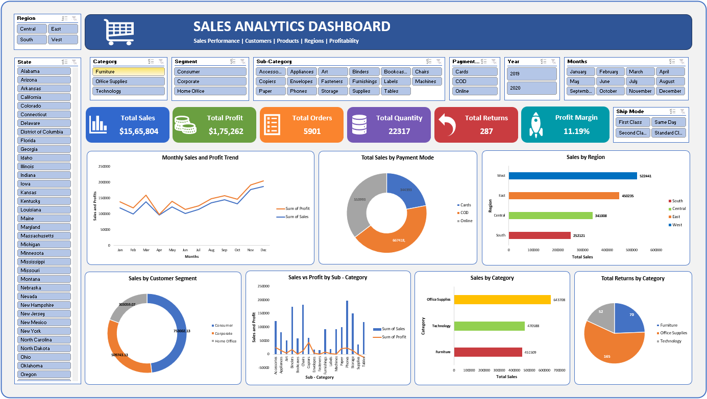

# Sales Performance Analysis Dashboard | Microsoft Excel

## Project Overview
This project presents an interactive Sales Analytics Dashboard built using Microsoft Excel to explore sales performance, profitability, regional trends, customer segments, product categories, payment methods, and returns.

## Dashboard Preview

## Business Objectives
- Monitor key sales and profitability metrics.
- Analyze monthly sales and profit trends.
- Compare performance across regions and product categories.
- Understand customer segment and payment mode patterns.
- Track product returns and shipping preferences.

## Tools & Skills
- Microsoft Excel
- PivotTables and PivotCharts
- Interactive Slicers
- KPI Reporting
- Data Analysis and Visualization
- Business Intelligence

## Key Dashboard Metrics
- Total Sales
- Total Profit
- Total Orders
- Total Quantity
- Total Returns
- Profit Margin

## Interactive Filters
The dashboard allows users to explore data using filters for region, state, category, segment, sub-category, payment mode, year, month, and ship mode.

## Key Insights
Add 3–5 verified findings from your analysis here. For each finding, explain what you observed and why it matters to the business.

## Recommendations
Add actionable recommendations supported by the data, such as opportunities to improve regional performance, profitability, or return management.

## Project Files
- `Sales_Analytics_Dashboard.xlsx` — Interactive Excel dashboard and analysis.
- `dashboard-screenshot.png` — Dashboard preview.

## Author
Data Analytics Portfolio Project

**Tools:** Microsoft Excel | Data Analysis | Data Visualization
